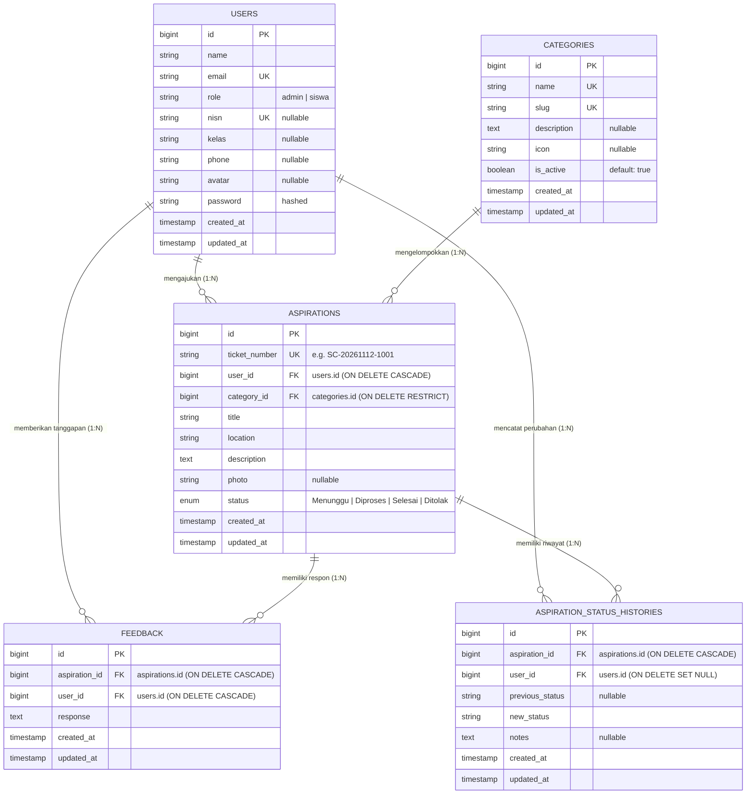

# ENTITY RELATIONSHIP DIAGRAM (ERD) & STRUKTUR TABEL DATABASE
## Sistem Pengaduan Sarana dan Prasarana Sekolah (SchoolCare)

---

### 1. Diagram ERD (Mermaid)

---

### 2. Deskripsi Relasi Antar Tabel

1. **`users` -> `aspirations` (One-to-Many)**:
   - Satu pengguna (siswa) dapat mengajukan banyak pengaduan sarana.
   - Kunci relasi: `aspirations.user_id` mereferensikan `users.id` dengan aturan `ON DELETE CASCADE`.

2. **`categories` -> `aspirations` (One-to-Many)**:
   - Satu kategori sarana mencakup banyak pengaduan fasilitas.
   - Kunci relasi: `aspirations.category_id` mereferensikan `categories.id` dengan aturan `ON DELETE RESTRICT` untuk mencegah terhapusnya kategori yang sedang digunakan oleh data aspirasi.

3. **`aspirations` -> `feedback` (One-to-Many)**:
   - Satu pengaduan sarana dapat memiliki beberapa tanggapan atau instruksi berkala dari administrator.
   - Kunci relasi: `feedback.aspiration_id` mereferensikan `aspirations.id` dengan aturan `ON DELETE CASCADE`.
   - `feedback.user_id` mereferensikan `users.id` (administrator yang memberikan feedback).

4. **`aspirations` -> `aspiration_status_histories` (One-to-Many)**:
   - Setiap pengaduan memiliki histori audit trail setiap kali terjadi perubahan status (`Menunggu` -> `Diproses` -> `Selesai` / `Ditolak`).
   - Kunci relasi: `aspiration_status_histories.aspiration_id` mereferensikan `aspirations.id` dengan aturan `ON DELETE CASCADE`.
   - `aspiration_status_histories.user_id` mereferensikan `users.id` dengan aturan `ON DELETE SET NULL` agar riwayat tetap tersimpan utuh meskipun akun pengubah dihapus di kemudian hari.

